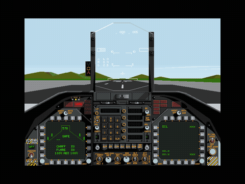
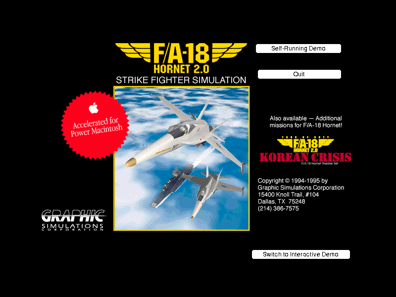
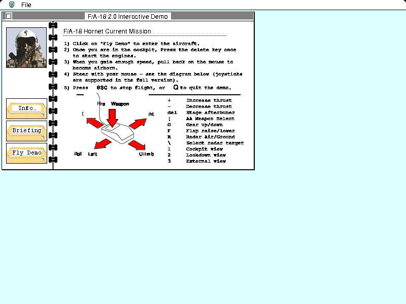
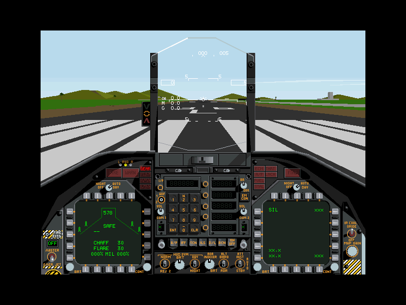
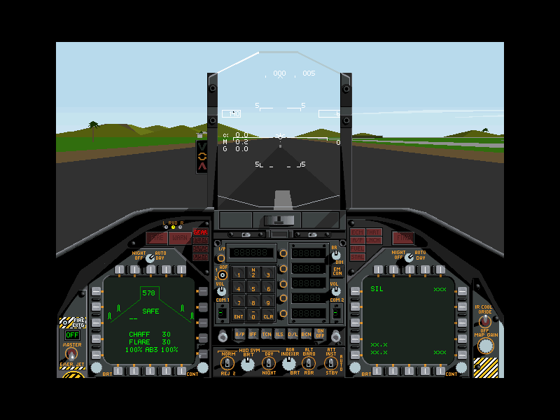
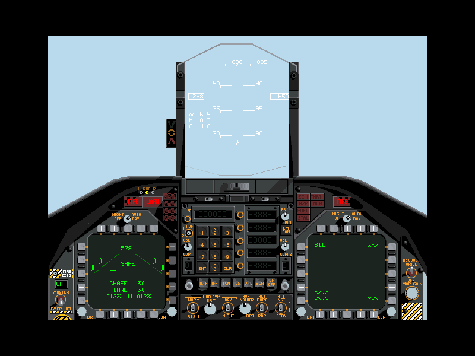
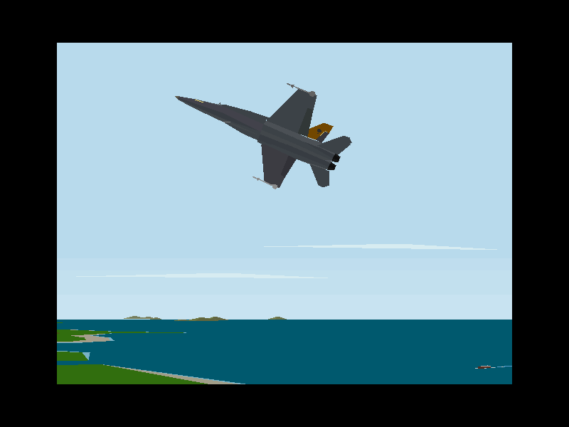

# F/A-18 Hornet 2.0 on modern computers

Play Graphsim's **F/A-18 Hornet 2.0** (1995, classic Mac OS) on current macOS
and Windows. This project uses
[Systemless](https://github.com/benletchford/systemless), a Rust program that
replaces the classic Mac Toolbox. Systemless runs the original game with no
Mac ROM, no System software and no machine emulator.



> **This project contains no game files.** Use your own copy of
> F/A-18 Hornet 2.0. Do not ask for copies of the game, and do not post them
> in issues. This project is not affiliated with Graphic Simulations
> Corporation, Graphsim Entertainment or the Systemless project.

## Made with AI

An AI agent did most of the work in this project. Claude Code, from Anthropic,
did these tasks:

- It found the cause of the failures and wrote the two Systemless patches.
- It wrote the launcher, the scripts, the release workflow and this README.
- It made the screenshots and the video with automated, headless runs.

I (Jaime Oyarzun) directed the work, supplied my copy of the game, and
reviewed the results. Read the patches and the scripts before you trust them.

## Screenshots

All images come from the free 2.0 demo. The publisher's demo documentation
permits free distribution of the demo.

| | |
| --- | --- |
|  |  |
| Title screen | Briefing |
|  |  |
| Cockpit on the runway | Takeoff roll with afterburner |
|  |  |
| Climb after takeoff | External view |

The [demo video](docs/media/hornet-demo.mp4) (47 seconds, no sound) shows the
full flight.

## Status

The 68K version of the game runs, with two small patches to Systemless.

- **Retail 2.0.1:** the game starts directly from the installer disc. These
  parts work: registration, the pilot dossier, the briefing, the menus, the
  Load Armament screen, the carrier-deck cockpit, engine start and the deck
  roll.
- **Free 2.0 demo:** the title screen, the briefing, the cockpit, takeoff,
  climb and the external view work.
- **Platforms:** the windowed game starts on macOS with Apple silicon. The
  Intel macOS build passes the automatic demo test under Rosetta. The Windows
  build compiles and passes the Systemless tests in CI, but nobody has run
  the game on Windows yet.

## Download

Get a build from the [releases page](https://github.com/mitoyarzun/hornet/releases).
You do not need a terminal.

| Computer | File |
| --- | --- |
| Mac with Apple silicon (M1 or later) | `hornet-VERSION-aarch64-apple-darwin.zip` |
| Mac with an Intel processor | `hornet-VERSION-x86_64-apple-darwin.zip` |
| Windows, 64-bit | `hornet-VERSION-x86_64-pc-windows-msvc.zip` |

1. Extract the zip file.
2. Double-click **F-A-18 Hornet** (macOS) or **F-A-18 Hornet.exe** (Windows).
3. At the first start, select your game file in the file dialog.

The launcher remembers the game file, so the next starts go directly to the
game. If the game file moves, the launcher asks for it again. If the game
stops with an error, the launcher shows the error and lets you select a
different file. On Windows, you can also drag a game file onto
**F-A-18 Hornet.exe**.

The builds are not signed by a registered developer, so the first start
needs one extra step:

- **macOS:** double-click the app, and click **Done** in the warning. Open
  **System Settings > Privacy & Security**, and click **Open Anyway** next to
  "F-A-18 Hornet".
- **Windows:** if SmartScreen stops the program, click **More info**, then
  **Run anyway**.

The launcher keeps the path of the game file and the log of the last game in
`~/Library/Application Support/hornet` (macOS) or
`%APPDATA%\hornet` (Windows).

## Your copy of the game

Systemless reads these formats:

- StuffIt archives (`.sit`)
- MacBinary files (`.bin`)
- HFS disk images: raw, DiskCopy 4.2, and Apple-partitioned CD images such
  as Toast

A plain copy of the game from a modern disk loses its resource fork. Use one
of the formats above.

The retail installer disc works directly. You do not install the game first.
Systemless opens the Installer VISE archive on the disc and starts
`F/A-18 Hornet 2.0.1`. It does not start the installer or the Acrobat Reader
on the disc. The test used a Toast image of the disc (volume
"F/A-18 Hornet 2.0", March 1996), both alone and inside a StuffIt archive.

At the first start, the game asks for the serial number. The serial number is
on the Product Registration card, in the back of the Pilot Flight Manual. The
disc also contains the full manual as `Hornet 2.0 Manual.pdf`.

To make a disk image from the original CD on a Mac, use these commands. We
did not test them.

```sh
diskutil list                          # find the CD drive, for example /dev/disk4
diskutil unmountDisk /dev/disk4
sudo dd if=/dev/rdisk4 of=hornet.iso bs=2048
```

## Flying

The pointer position is the control stick. Put the mouse in the center of the
screen before you increase thrust.

To start a mission, open the **Mission** menu:

- **Training…** opens the six training missions. The first one starts on a
  runway.
- **Fly** starts the current Tour of Duty mission. It opens the Load Armament
  screen. Click **Fly** on that screen to go to the cockpit.

| Input | Action |
| --- | --- |
| Mouse forward / back | Dive / climb |
| Mouse left / right | Roll |
| Mouse button | Fire the selected weapon |
| Delete | Set thrust to 100%; each next press adds one afterburner stage |
| `+` / `-` | Increase / decrease thrust |
| Space bar | Wheel brake on the ground; speed brake in the air |
| `G` | Landing gear up / down |
| `F` | Flaps |
| `R` | Radar air / ground |
| `[` | Air-to-air weapon select |
| `\` | Select radar target |
| `D` | Damage report |
| `1` `2` `3` | Cockpit / look-down / external view |
| Esc | Stop the flight |

**Takeoff from a runway:** press Delete once, then press it three more times
for afterburner. Pull back on the mouse at 120 to 140 knots. Release
the pull after liftoff, or the jet loops.

**Carrier launch** (from the manual, page 25):

1. Taxi to the start of a catapult.
2. Hold the Space bar until the jet stops fully. The brake then locks.
3. Increase thrust to 100%. The nose goes down when the catapult tightens.
4. Push and release the Space bar to launch, then pull back on the mouse.

The Kuwait mission starts on the carrier deck, but not on a catapult.

## Build from source

You need Rust from [rustup.rs](https://rustup.rs). On Linux, also install
`libasound2-dev`.

```sh
tools/setup-systemless.sh               # get Systemless 38666a8, apply patches/, build
tools/smoke-demo.sh                     # get the free 2.0 demo, fly it without a window
tools/run-hornet.sh path/to/Hornet.sit  # play in a window
```

To build the double-click launcher, run
`cargo build --release --manifest-path launcher/Cargo.toml`. The launcher
starts the `systemless` binary that is in the same folder.

The release build takes several minutes because it uses full link-time
optimization. `PROFILE=ci-test` builds faster, and the game runs a little
slower. Set `TARGET` to build for a different Rust target. All downloads and
build output go into `out/`, and git ignores that directory.

To make a new demo video, generate the play script with
`python3 -I tools/make-demo-video.py > out/video.json`. Then run Systemless
with `--headless --play-script out/video.json`, and join the frames with
ffmpeg at 30 frames per second.

## The patches

Both patches apply to Systemless commit `38666a8` (version 0.96.0). The
Systemless library tests pass with the patches.

**`0001-open-hfs-basenames-containing-slash.patch`** is the important patch.
Without it, the game shows "Sorry, I can't find the file "F/A-18 Data"".

- On HFS, only `:` separates the parts of a path. Thus the `/` in
  "F/A-18 Data 2.0" is a part of the filename.
- Systemless stores a `/` in a filename as an escaped character (U+F02F).
  `HOpen` decodes this character correctly.
- Two other name lookups do not decode it: `find_vfs_file` (data forks, for
  `PBOpen`) and `find_vfs_rsrc_file` (resource forks, for `OpenResFile`).
  When a name contains a `/`, they skip their basename search, and they do
  not find the file.

The demo opens the data fork, and the retail game opens the resource fork.
The patch lets both lookups find a filename without `:` by its basename. It
also adds a unit test for each lookup. The Systemless catalogue shows that the
demo reached the cockpit on version 0.51.0, so this bug is probably a
regression.

**`0002-ppc-alias-tesetscraplength.patch`** is for the PowerPC version only.
`TESetScrapLength` is the same call as `LMSetTEScrpLength`, and Systemless
already has `LMSetTEScrpLength`. The patch adds the missing alias. This patch
alone does not make the PowerPC version run.

## Things to know

- **Select the game application.** The demo archive also contains a
  PowerPC documentation reader. Systemless prefers PowerPC applications, so
  `systemless demo.sit` opens the documentation. The launcher and
  `run-hornet.sh` set `SYSTEMLESS_LOAD_EXECUTABLE=Hornet` to select the game.
- **Use the 68K version.** Hornet 2.0 contains a 68K version and a PowerPC
  version. The PowerPC version stops at once, because Systemless does not have
  16 of its 343 InterfaceLib imports:
  `LMGetMainDevice`, `LMGetROM85`, `LMGetFCBSPtr`, `LMGetEventQueue`,
  `LMSetSEvtEnb`, `LMGetTEScrpHandle`, `LMSetTEScrpHandle`, `BitShift`,
  `DeltaPoint`, `AngleFromSlope`, `SystemEvent`, `RecoverHandleSys`,
  `DrvrInstall`, `PConfirmName`, `PrJobMerge` and `LNextCell`.
  `tools/pef_imports.py` lists the imports of a PEF file. The launcher and
  `run-hornet.sh` pass `--prefer-68k`.
- **No network play.** The game looks for the AppleTalk driver (`.MPP`).
  Systemless does not have this driver, so *Network Host* and
  *Network Join* stay disabled.
- **Saved files.** Systemless keeps saved files in `.systemless/saves/`,
  beside your game archive. The game keeps its registration in its
  preferences file, so you probably register only once. We did not verify
  this.
- **Automatic test.** `play/fly-demo.json` flies the demo without a window. It
  waits for the sky color in the cockpit and checks the instrument panel. It
  fails if the data-file bug comes back.

## Known issues

- On the retail Briefing page, the game draws the mission paragraph on top
  of a different text block, so you cannot read it. The Time, Conditions and
  Destination lines below it are correct.
- Joysticks are not tested.

## Not done yet

- Play tests on Windows and on an Intel Mac.
- The PowerPC version, which needs the 16 imports above.
- A request to include the patches in Systemless.

## License and credits

This project is licensed under the GNU General Public License, version 3 or
later ([LICENSE](LICENSE)). Systemless has the same license, and the patches
change Systemless code. Each release includes the corresponding Systemless
source.

- [Systemless](https://github.com/benletchford/systemless) is by Ben
  Letchford.
- F/A-18 Hornet is a product of Graphic Simulations Corporation.
- [Systemless issue #2713](https://github.com/benletchford/systemless/issues/2713)
  has an earlier Hornet fix (File Manager FCB reference numbers).
- The [Hornet 2.0 demo](https://classicmacdemos.com/fa-18-hornet-20) is on
  Classic Mac Demos.
